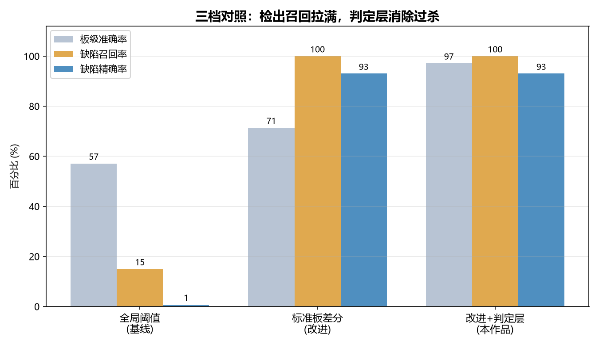
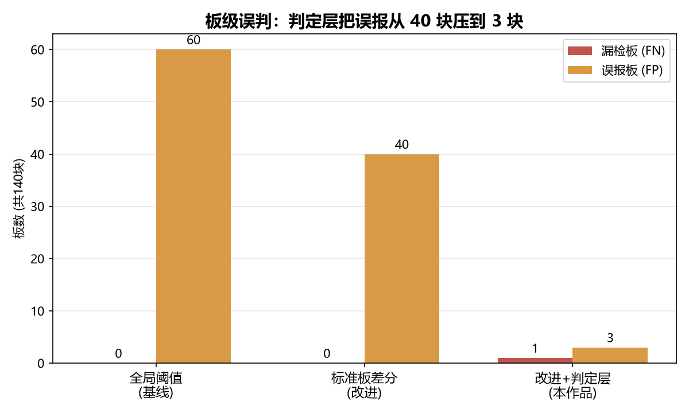
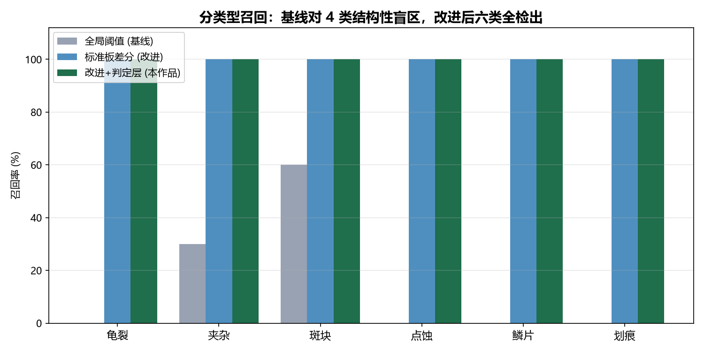

# Steel Quality Gate · 钢材表面缺陷智能质检台

> 面向热轧钢带产线的**可解释质量判定层**。不把「用了 YOLO/AI」当创新——真正的改动在**标准板参考差分抑制轧制纹理 + 误报过滤 + 致命度分级 + 板级可解释判定**，并用可复现基准给出三档对照实测。

版本：1.0.0 | 技术栈：Python 3.13 · NumPy · OpenCV · 标准库 HTTP 服务（零 Web 框架）| 许可：MIT

---

## 1. 问题场景与价值

热轧钢带表面质检中，检测只是手段，**产线真正要的决策是「这一卷能不能放行」**。两个一线痛点：

- **漏检**：龟裂、点蚀这类低对比缺陷，在「看当前图做全局阈值」的传统方法下结构性看不见（有周期性轧制纹理干扰）；
- **过杀**：一个 0.2mm 的轻微划痕也判 NG，导致大量本可放行的钢卷被误废。

受影响对象：热轧产线质检员、AOI 设备集成商。可测量价值：**同一批 140 块板，板级误判从 43 块降到 4 块**（见第 4 节）。

## 2. 方案与核心创新点

系统分三层，前端检测器可替换，创新集中在判定层：

```
观测钢带 ─→ [前端检测] ─→ 候选缺陷框 ─→ [判定层] ─→ OK/NG + 严重度 + 逐条理由
              │                            │
        基线: 全局 Otsu 阈值          ① 误报过滤（面积/贴边）
        改进: 标准板参考差分          ② 致命度分级（钢材行业简化规则）
        (可替换为 YOLO bbox)         ③ 板级判定 + 可解释输出
```

**最小创新点（一条主线）**：在检测结果之上增加一层**可解释的致命度判定**——把「检出缺陷」变成「按工艺严重度决定放行的决策」，并明确区分「检出层」和「判定层」的贡献，使两者可独立评测。

**具体技术改动（相对基线）**：

| 环节 | 基线做法 | 本作品改动 | 为什么有效 |
|---|---|---|---|
| 缺陷发现 | 全局 Otsu 阈值，只看「当前图像素」 | 标准板参考差分（golden board comparison） | 轧制纹理与光照渐变在差分中抵消，低对比缺陷显现 |
| 缺陷分类 | 不分类，统一 unknown | 连通域形状先验 → 6 类 + 严重度 | 碎片数/填充率/长宽比区分划痕、龟裂、点蚀 |
| 板级决策 | 有框即 NG | 误报过滤 + 致命度分级 + 可解释理由 | minor 缺陷放行，减少过杀；输出可追溯 |

> 说明：改进层前端用参考差分实现，**接口 `Detection` 与 YOLO bbox 对齐**，替换检测模型不需要改判定层。刻意不依赖深度学习权重，保证零依赖、可现场复现——这本身就是工程完整性的一部分。

## 3. 数据与方法

**数据集**：程序化合成，对齐东北大学 NEU-DET 的 6 类热轧钢带缺陷（crazing 龟裂 / inclusion 夹杂 / patches 斑块 / pitted_surface 点蚀 / rolled-in_scale 轧制鳞片 / scratches 划痕）。合成器 `steelqg/synth.py` 用 `seed` 控制，带水平轧制纹理与光照渐变背景，完全可复现。

> 为什么用合成数据：真实 NEU-DET 需向作者申请；本作品用参数化合成提供**等价的可复现实验条件**，并显式声明这一限制（见第 5 节）。

**实验设置**（`experiments/results.json`）：140 块板 = 6 类 × 20 + 20 块良板；IoU 命中阈值 0.15，三档完全一致以保证对照公平。

**指标**：缺陷级召回率/精确率/F1、分类型召回；板级判定准确率、漏检板(FN board)、误报板(FP board)；严重度判定准确率。

## 4. 结果（实测，非估算）

| 档位 | 缺陷召回 | 板级准确率 | 漏检板 | 误报板 | 严重度准确率 | F1 |
|---|---|---|---|---|---|---|
| 基线 · 全局阈值 | 15.0% | 57.1% | 0 | 60 | — | 0.014 |
| 改进 · 标准板差分 | 100% | 71.4% | 0 | 40 | 96.7% | 0.964 |
| **改进 + 判定层** | **100%** | **97.1%** | **1** | **3** | **96.7%** | **0.964** |

**读法**：

- 基线对 4 类缺陷（龟裂/点蚀/鳞片/划痕）召回为 0 —— 轧制纹理淹没低对比缺陷，这是它的结构性盲区，见 `fig3_per_class.png`；
- 改进层把召回拉到 100%，但因为**不分级**，40 块 minor 缺陷板全部过杀，板级准确率仅 71.4%；
- 判定层过滤误报并按严重度放行 minor 缺陷，把板级误判从 40 块压到 3 块。





## 5. 失败边界与限制（诚实声明）

1. **合成数据 ≠ 真实产线**：真实热轧钢带有氧化皮、水渍、密集纹理、反光，本基准无法覆盖；迁移需重新采集标准板并标定。
2. **依赖标准板**：参考差分要求一张对齐的理想板；产线需首件检验或 CAD 渲染图生成，存在配准误差来源。
3. **形状分类是启发式**：严重度判定准确率 96.7%，仍有约 3.3% 分错，边界样本（介于划痕与龟裂之间）会误分级。
4. **极小缺陷**：hard 档缺陷缩小后分类稳定性下降，需更大分辨率或更高对比成像。

## 6. 现场演示

```bash
# 方式一：双击 exe（推荐，自动开浏览器，无需 Python）
dist/SteelQualityGate.exe

# 方式二：Windows 双击 bat（自动开浏览器）
run_demo.bat

# 方式三：命令行
python server.py            # 打开 http://127.0.0.1:8766
```

界面功能：选缺陷类型/种子/难度 → 生成样本并检测 → 五视图对照（原图/真值/基线/改进/判定层）→ 判定理由 → 一键运行三档对照实验。全程本地计算。

```bash
# 命令行跑实验
python -c "from steelqg import run_experiment; import json; print(json.dumps(run_experiment(),ensure_ascii=False,indent=2))"

# 生成图表
python experiments/make_figures.py

# 单元测试
python -m unittest discover -s tests -v     # 14 tests, all passed
```

## 7. 目录结构

```
steel-quality-gate/
├─ steelqg/                核心包
│  ├─ synth.py             可复现样本合成器（含真值）
│  ├─ detector.py          基线 / 改进检测 / 判定层
│  ├─ evaluate.py          评测与三档对照
│  └─ __init__.py
├─ web/index.html          演示界面（五视图）
├─ server.py               本地 HTTP 服务（标准库）
├─ run_demo.bat            一键启动
├─ experiments/            对照脚本 + results.json + figures/
├─ tests/                  单元测试（14 项）
├─ flow.md                 系统流程图与答辩讲述顺序
├─ VERSION / requirements.txt
└─ README.md               本文件
```

## 8. 参考开源项目

- `doohuan-ai/steel-defect-detection`（YOLOv8 + NEU-DET/GC10-DET 钢材缺陷检测）
- `us-bit/Steel_Plate_Defect_Detection`（YOLOv8 六类钢材缺陷完整流程）
- 数据集来源：Ding et al., TDD-net, CAAI TIT 2019（东北大学 NEU-DET）
